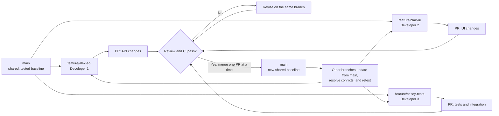

# Three-Developer GitHub Workflow for AI-Assisted Development

This workflow lets three developers work on the same vertical slice without overwriting one another or destabilizing `main`. Each developer works on a short-lived feature branch, opens a pull request (PR), passes automated checks, receives review, and merges one change at a time.

> **Core rule:** nobody commits directly to `main`. A push updates only the developer's branch; code reaches `main` only through a reviewed, passing PR.

## Workflow at a glance



The arrows are the actual path changes follow. Feature branches begin at `main`; PRs are reviewed and tested; accepted work returns to `main`; remaining branches then update from the new baseline.

## 1. Split the vertical slice before coding

Working on one vertical slice does **not** require everyone to edit the same files. Divide the slice at stable boundaries and agree on the interface first.

Example ownership:

| Developer | Primary responsibility | Typical files |
| --- | --- | --- |
| Developer 1 | API, service, and database changes | routes, controllers, services, migrations |
| Developer 2 | UI and client state | components, pages, hooks, styles |
| Developer 3 | integration, shared types, and tests | schemas, contracts, fixtures, end-to-end tests |

Before starting, write down:

- the API request and response shape;
- shared types, validation rules, and error behavior;
- which developer owns each file or module;
- the expected test cases;
- the order in which dependent PRs should merge.

If two people must edit the same file, coordinate the order. Prefer one person making the structural change first, merging it, and the other updating their branch before adding the dependent change.

## 2. Create one branch per task

Start from an up-to-date `main` and use a branch name that identifies the work, not the developer alone.

Examples:

```text
feature/profile-api
feature/profile-form
test/profile-integration
fix/profile-validation
```

Keep each branch focused on one reviewable outcome. Do not reuse a merged branch for unrelated work.

### GitHub Desktop

1. Select the repository.
2. Switch to **Current branch → main**.
3. Select **Fetch origin**, then **Pull origin** if updates are available.
4. Select **Current branch → New branch**.
5. Enter the branch name and create it from `main`.
6. Select **Publish branch** so the branch is backed up on GitHub.

### Command line equivalent

```bash
git switch main
git pull --ff-only origin main
git switch -c feature/profile-api
git push -u origin feature/profile-api
```

## 3. Make small, deliberate commits

Commit a coherent change whenever the code is in a useful state. Small commits are easier to review, revert, and resolve during conflicts.

Good commit messages describe the result:

```text
Add profile update endpoint
Validate profile form before submit
Cover invalid profile payloads
```

Before committing:

- review every changed file and remove accidental edits;
- run formatting, linting, type checking, and relevant tests;
- confirm generated code did not change unrelated behavior;
- do not commit secrets, local configuration, build output, or dependency folders.

### AI-specific guardrails

Treat AI output as an untrusted draft until a developer has reviewed and tested it.

- Give the AI the task boundary and files it may change.
- Ask it to explain planned cross-module changes before applying them.
- Inspect the diff after every meaningful generation step.
- Reject broad refactors that are unrelated to the task.
- Never ask multiple agents or developers to rewrite the same shared file independently.
- Keep lockfile, schema, migration, and generated-client changes intentional and separately reviewable.
- A human remains responsible for every pushed line.

## 4. Push the branch without affecting teammates

Pushing a feature branch cannot overwrite `main` or another developer's branch unless someone explicitly force-pushes to that branch.

### GitHub Desktop

1. Review the **Changes** tab.
2. Enter a summary and optional description.
3. Select **Commit to _your-branch_**.
4. Select **Push origin**.

Push frequently so work is backed up and visible. Do not force-push shared branches. If a branch belongs to one developer, a force-push should still be rare and announced because it can invalidate review comments and commit references.

## 5. Open a pull request early

Open a draft PR once the direction is clear, even if the work is incomplete. This exposes overlap and interface problems before they become large conflicts.

A useful PR includes:

- **What:** the behavior that changed;
- **Why:** the issue or requirement it addresses;
- **How to test:** exact steps and commands;
- **Risk:** migrations, shared contracts, security, or deployment concerns;
- **Screenshots:** for visible UI changes;
- **Dependencies:** another PR that must merge first;
- **AI disclosure:** important generated areas that deserve extra scrutiny.

Suggested PR checklist:

```markdown
## Summary

## Test plan
- [ ] Unit tests pass
- [ ] Integration tests pass
- [ ] Manual happy path checked
- [ ] Error and edge cases checked

## Coordination
- [ ] Shared contract changes communicated
- [ ] No unrelated generated changes
- [ ] Depends on / blocks another PR: N/A
```

## 6. Review and merge PRs one at a time

At least one teammate should review every PR. The reviewer should check behavior and integration, not only formatting.

Review for:

- correctness and acceptance criteria;
- unintended edits or duplicated logic;
- API and type compatibility;
- authorization, validation, and error handling;
- adequate tests;
- migration safety and rollback concerns;
- whether the change is small enough to understand confidently.

When multiple PRs touch the same vertical slice, choose a merge order. Merge the lowest-level contract or backend change first, then update dependent branches, retest, and merge the next PR.

Use **Squash and merge** for most short-lived feature branches. It keeps `main` readable while preserving the detailed branch commits during review. Delete the remote branch after merging.

## 7. Update active branches after every related merge

Before final review—and whenever a related PR merges—bring the latest `main` into the active branch. This moves conflict resolution to the developer who understands the branch.

### GitHub Desktop: safest simple method

1. Commit or stash current work.
2. Switch to `main`.
3. Select **Fetch origin**, then **Pull origin**.
4. Switch back to the feature branch.
5. Select **Branch → Update from main**.
6. Resolve conflicts if prompted.
7. Run the complete relevant test suite.
8. Commit the conflict resolution if needed, then push.

### Command line equivalent using merge

```bash
git switch main
git pull --ff-only origin main
git switch feature/profile-form
git merge main
```

Teams comfortable with rebasing may use `git rebase main` instead, but everyone should use the same convention. Rebasing a published branch rewrites its history and may require a force-push, so do not make it the default for beginners or shared branches.

## 8. Resolve conflicts as integration work

A conflict means Git cannot safely choose between two edits. It does not mean either developer's work should simply replace the other.

When a conflict occurs:

1. Stop and identify the intended combined behavior.
2. Ask the authors of both changes to resolve it together when the behavior is unclear.
3. Keep the necessary parts from both sides; do not blindly select “ours” or “theirs.”
4. Remove all conflict markers.
5. Build and test the combined result.
6. Review the conflict-resolution diff before pushing.

Git conflict markers look like this:

```text
<<<<<<< HEAD
your branch's version
=======
main's version
>>>>>>> main
```

The final file must contain the correct combined code and none of these marker lines.

## 9. Protect `main` in GitHub

In the repository's GitHub settings, create a ruleset or branch protection rule for `main` with these controls:

- require a pull request before merging;
- require at least one approval;
- dismiss stale approvals when new code is pushed;
- require conversation resolution;
- require status checks to pass;
- require the branch to be up to date before merging when practical;
- block force pushes and branch deletion;
- restrict direct pushes to `main`;
- apply the rules to administrators as well, if the team wants no bypasses.

Keep merge methods consistent. Enabling squash merge and disabling unused methods reduces uncertainty.

Recommended repository files:

```text
.github/
  pull_request_template.md
  CODEOWNERS
  workflows/
    ci.yml
```

Use `CODEOWNERS` only when ownership is real and maintained. It should route review, not create a bottleneck where only one person can understand a subsystem.

## 10. Require tests before merge

The exact commands depend on the stack, but CI should cover the same checks developers run locally.

| Check | Purpose | Run when |
| --- | --- | --- |
| Formatting | Prevent noisy style-only diffs | Before commit and in CI |
| Linting | Catch suspicious patterns | Before push and in CI |
| Type checking | Catch contract mismatches | Before push and in CI |
| Unit tests | Verify isolated behavior | During development and in CI |
| Integration tests | Verify API, database, and service boundaries | Before PR approval and in CI |
| End-to-end smoke test | Verify the complete vertical slice | Before merge or deployment |
| Build | Confirm production compilation succeeds | In CI on every PR |

For a full-stack slice, test at minimum:

- the happy path;
- validation failures;
- authorization failures;
- API and UI agreement on payloads and errors;
- database migration behavior;
- loading, empty, and failure states in the UI;
- a regression scenario for the bug or requirement being addressed.

A PR is not ready because “it works on my machine.” It is ready when its branch is current enough to integrate, required CI checks pass, and a reviewer can reproduce the expected behavior.

## 11. Coordinate with a lightweight change map

Use an issue, project board, or short team message to make overlap visible.

Example:

```text
Vertical slice: Edit profile

Alex — profile endpoint and migration — feature/profile-api
Blair — form and client state — feature/profile-form
Casey — shared schema and E2E tests — test/profile-integration

Shared contract owner: Casey
Merge order: schema → API → UI → E2E adjustments
Known overlap: src/types/profile.ts
```

Post a short update when:

- a shared interface changes;
- a PR is ready for review;
- a PR merges and others need to update;
- a migration or dependency is introduced;
- a conflict requires both authors.

Avoid long-lived branches and large surprise PRs. Fifteen minutes of coordination usually costs less than reconstructing several days of overlapping AI-generated changes.

## Daily operating checklist

### Start of work

- [ ] Pull the latest `main`.
- [ ] Create or switch to the task branch.
- [ ] Confirm ownership, contracts, and expected tests.
- [ ] Check related PRs for changes that affect the task.

### Before pushing

- [ ] Review the entire diff.
- [ ] Remove unrelated AI-generated changes.
- [ ] Run formatting, linting, type checks, and relevant tests.
- [ ] Commit with a clear message.
- [ ] Push only the feature branch.

### Before merging

- [ ] Update the branch from the latest `main`.
- [ ] Resolve conflicts with the affected teammate.
- [ ] Rerun tests after integration.
- [ ] Confirm required checks pass.
- [ ] Obtain approval and resolve review comments.
- [ ] Squash-merge, then delete the branch.

### After another PR merges

- [ ] Pull the new `main`.
- [ ] Update any dependent branch.
- [ ] Recheck shared contracts and generated files.
- [ ] Run the affected tests again.

## What not to do

- Do not commit directly to `main`.
- Do not share one working branch among all three developers.
- Do not use force-push to “fix” a teammate's branch.
- Do not resolve conflicts by accepting one whole side without understanding the result.
- Do not merge failing or unreviewed code to unblock yourself.
- Do not allow AI to make repository-wide changes when the task is narrow.
- Do not combine feature work, refactoring, formatting, and dependency upgrades in one PR.

## Recommended default policy

For a three-person team, the simplest dependable default is:

1. `main` is always protected and expected to build.
2. Every task gets a short-lived feature branch from current `main`.
3. Every change reaches `main` through a PR with one approval and passing CI.
4. Related PRs merge one at a time in an agreed order.
5. Remaining branches update from `main` and retest after each related merge.
6. AI-generated code receives the same human review and testing as handwritten code.

This process does not eliminate conflicts; it makes them smaller, visible earlier, and resolved by the people who understand the intended behavior.
